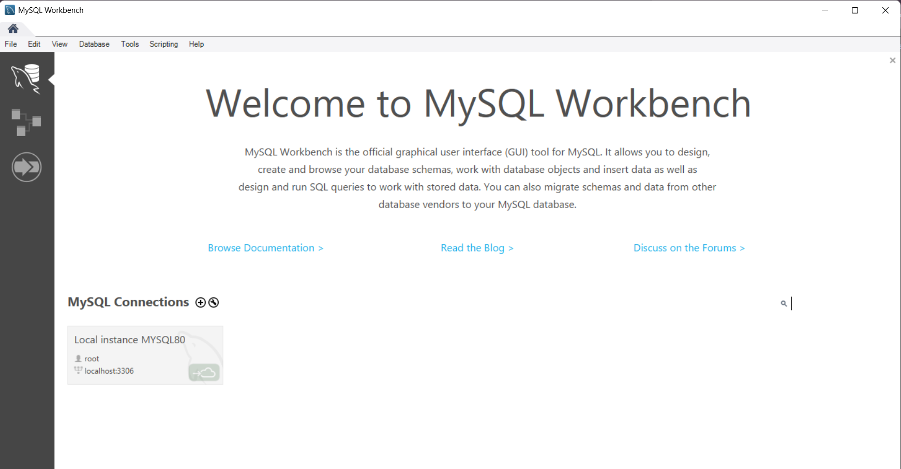
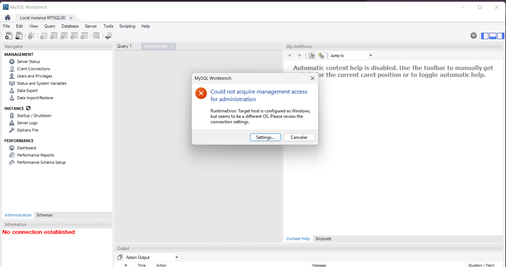
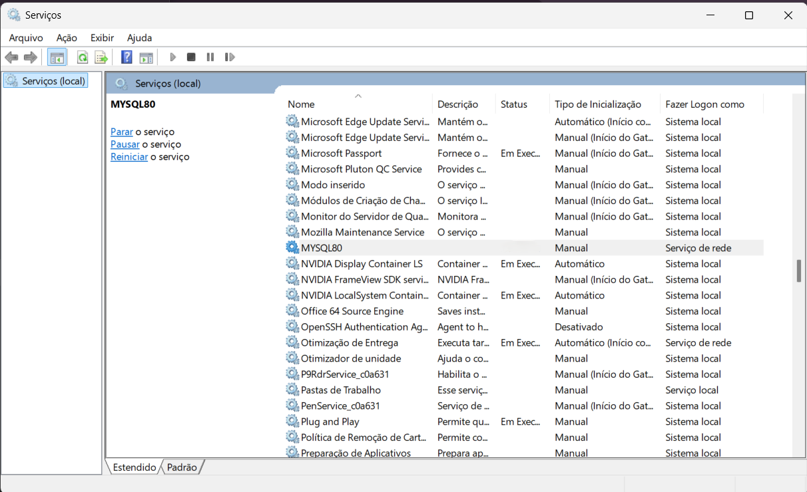
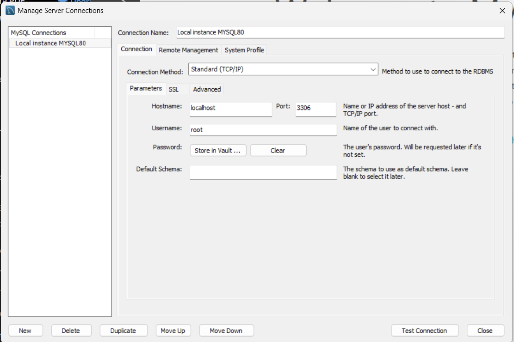
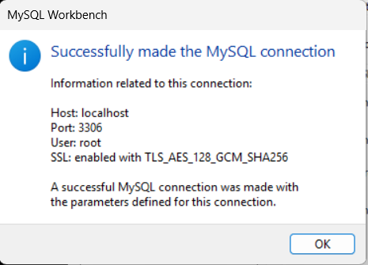
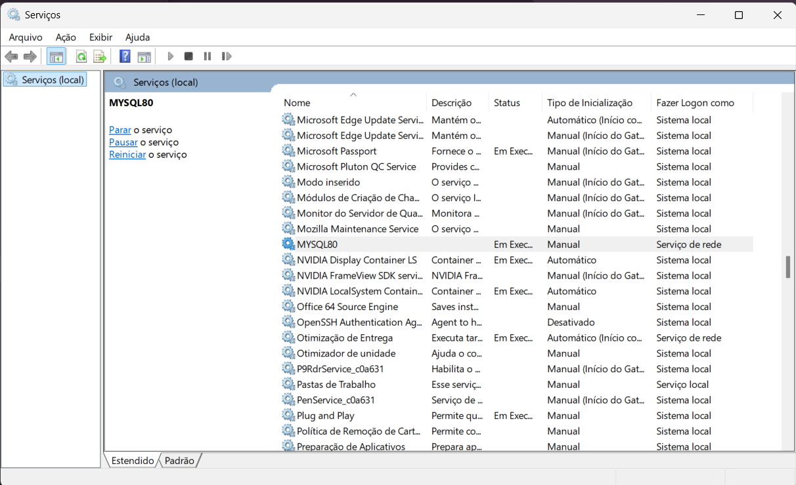
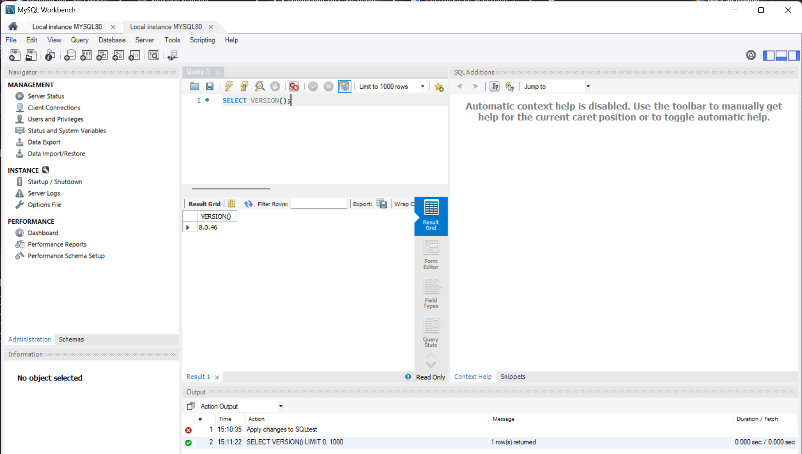

# Case 003 — MySQL Server Installation and Workbench Configuration

## Executive Summary

This case study documents the verification and troubleshooting of a local MySQL environment using MySQL Server 8.0 and MySQL Workbench.

The initial investigation focused on an administration access error encountered in MySQL Workbench. The troubleshooting process included Windows service verification, database connection testing, authentication, and SQL query execution.

The environment was successfully validated through a local database connection and a SQL version query.

## Environment

| Component | Configuration |
|---|---|
| Database Management System | MySQL Server 8.0 |
| Database Administration Tool | MySQL Workbench |
| Operating System | Windows |
| Windows Service | MYSQL80 |
| Connection Method | Standard TCP/IP |
| Hostname | localhost |
| Port | 3306 |
| Database Account | root |



## Initial Issue

When accessing the administration features in MySQL Workbench, the following error appeared:

`Could not acquire management access for administration.`

The error also indicated an operating system mismatch between the configured target host and the detected environment.

At this stage, it was necessary to determine whether MySQL Server was installed and running correctly.



## Investigation

### 1. Windows Services Verification

Opened the Windows Services management console using:

`services.msc`

Located the `MYSQL80` service and inspected its configuration.

Initial observations:

- Service status: Stopped.
- Startup type: Manual.
- Logon account: Network Service.
- Description: Blank.

The service was manually started and its status changed to Running.



### 2. MySQL Workbench Connection Test

Inspected the existing connection:

`Local instance MYSQL80`

Verified the connection using the existing localhost configuration.



The connection test returned:

`Successfully made the MySQL connection.`

This confirmed that MySQL Workbench could authenticate and communicate with the local MySQL Server.




## Troubleshooting and Resolution

After confirming that the database service was running, the administration interface was accessed again.

The Server Status page opened without displaying the original administration access error.

No changes to the server installation were necessary.

The original error's root cause was not conclusively identified.



## Validation

A SQL query was executed in MySQL Workbench to verify server connectivity and retrieve the installed version.

**SQL command:**

```sql
SELECT VERSION();
```

**Result:**

The query executed successfully and returned MySQL version 8.0.x.



This validated:

- MySQL Server availability.
- Successful local connection.
- Database authentication.
- SQL query execution.

## Lessons Learned

- MySQL Server and MySQL Workbench serve different purposes.
- Windows Services can be used to inspect and manage database services.
- A successful database connection does not necessarily mean that all administration features are correctly configured.
- SQL queries provide a practical way to validate database connectivity and server functionality.

## Evidence

Screenshots documenting the investigation and validation process are stored in the `evidence/` directory.

## Engineering Philosophy

This case study follows an evidence-based troubleshooting approach.

The objective is to identify the problem, investigate the environment, perform controlled actions, and validate the results before considering the issue resolved.

